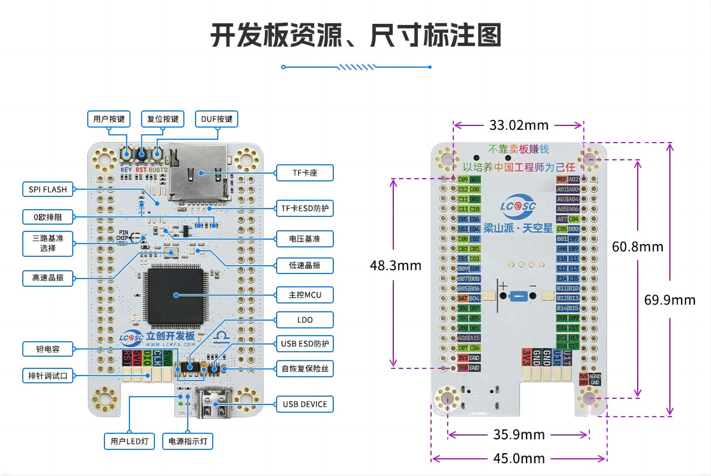

# 智能桌面盒子

[](https://www.st.com)
[](https://www.rt-thread.org/)
[](https://lckfb.com)

基于立创天空星 STM32F407VET6 开发板的开源智能桌面盒子项目。通过物理旋钮精确控制电脑音量与亮度，并集成了环境传感器、Wi-Fi 联网和 OLED 交互界面。



## 🎯 核心功能

| 功能 | 说明 | 状态 |
|------|------|------|
| 🎵 **音量控制** | USB HID 旋钮控制电脑系统音量 | ✅ 已完成 |
| ☀️ **亮度控制** | USB HID 旋钮控制电脑显示器亮度 | ✅ 已完成 |
| 🖥️ **OLED 菜单** | 完整的图形 UI 界面，中文显示 | ✅ 已完成 |
| 🌐 **Wi-Fi 联网** | ESP-01S AT 指令驱动，支持阿里云 MQTT | ✅ 已完成 |
| 🌡️ **温湿度采集** | DHT11 传感器实时环境数据 | ✅ 已完成 |
| ⌨️ **快捷键** | 4 个独立可编程按键 | ✅ 已完成 |

## 🛠️ 硬件规格

### 主控平台
- **芯片**: STM32F407VET6 (Cortex-M4, 168MHz, 512KB Flash, 192KB SRAM)
- **开发板**: 立创梁山派·天空星开发板
- **USB**: Full-Speed OTG (PA11/PA12)

### 板载外设与引脚映射

#### 显示模块
| 功能 | 引脚 | 说明 |
|------|------|------|
| OLED CS | PA4 | SPI1 片选 |
| OLED DC | PB0 | 数据/命令 |
| OLED RST | PB1 | 复位 |
| SPI1 SCK | PA5 | 时钟 |
| SPI1 MOSI | PA7 | 数据 |

#### 交互输入
| 功能 | 引脚 | 说明 |
|------|------|------|
| 旋钮 A 相 | PB12 | 编码器输入 |
| 旋钮 B 相 | PB13 | 编码器输入 |
| 旋钮按键 | PB14 | 按下确认 |
| 快捷键 K1 | PC0 | 可编程 |
| 快捷键 K2 | PC1 | 可编程 |
| 快捷键 K3 | PC2 | 可编程 |
| 快捷键 K4 | PC3 | 可编程 |

#### 通信与传感器
| 功能 | 引脚 | 说明 |
|------|------|------|
| ESP-01S RX | PA2 | USART2 TX |
| ESP-01S TX | PA3 | USART2 RX |
| DHT11 数据 | PB15 | 温湿度传感器 |
| 状态 LED | PB2 | 系统状态指示 |
| USB DM | PA11 | USB 设备端 |
| USB DP | PA12 | USB 设备端 |

## 🖥️ OLED UI 交互

系统提供了一个完整的 OLED 图形界面，包含多页面导航：

- **PC 页面**: 旋钮控制电脑音量/亮度，显示 USB 连接状态
  - `USB: OFF` — USB 栈未启动
  - `USB: ENUM` — USB 已启动，等待电脑枚举
  - `USB: SEND` — 正在发送 HID 事件
  - `USB: READY` — 就绪，可继续操作
- **传感器页面**: 实时显示 DHT11 温湿度数据
- **云服务页面**: Wi-Fi 连接状态与阿里云 MQTT 状态

操作逻辑：
1. 旋转旋钮浏览页面/选项
2. 按下旋钮进入编辑模式
3. 在编辑模式下旋转旋钮调节数值
4. 长按旋钮返回上级

## 📁 项目结构

```
end/
├── applications/          # 应用层代码
│   ├── system/            # 启动流程与应用入口
│   ├── services/          # 后台服务与跨模块协调
│   ├── usb/               # USB HID 应用层
│   ├── cloud/             # 阿里云 MQTT 协议与对接
│   ├── network/           # ESP-01S AT 驱动与 Wi-Fi 管理
│   ├── sensor/            # 物理传感器驱动
│   ├── data/              # 本地数据模型与快照
│   └── ui/                # OLED UI
│       ├── oled_ui_core/  # UI 引擎、绘图、字体、输入 HAL
│       ├── oled_ui_app/   # 产品页面、图标、文案
│       └── oled_ui_service/ # RT-Thread UI 服务线程
├── board/                 # 板级支持 (链接脚本、Kconfig 等)
├── libraries/             # HAL 库与驱动
├── rt-thread/             # RT-Thread 内核与组件
├── packages/              # 第三方软件包
├── docs/                  # 项目文档
│   ├── usb_pc_knob_control.md       # USB 旋钮控制分析
│   ├── expansion_board_design.md    # 扩展板设计方案
│   └── expansion_board_existing_peripherals_only.md  # 现有外设扩展板方案
└── RT-Thread 工程文件
    ├── project.uvprojx     # MDK5 工程
    ├── project.eww         # IAR 工程
    ├── SConstruct          # SCons 构建入口
    └── rtconfig.h          # RT-Thread 配置
```

## 🚀 快速上手

### 硬件准备
- 立创天空星 STM32F407VET6 开发板
- USB 转 TTL 模块（用于串口调试）
- **连接方式**：
  - 开发板 USB → 电脑供电
  - TTL 模块 RX → PA9 (MCU TX)
  - TTL 模块 TX → PA10 (MCU RX)

### 编译与下载

支持多种工具链：

**MDK5 (Keil)**
```bash
# 双击 project.uvprojx 打开工程
# 或使用 ENV 工具重新生成
scons --target=mdk5
```
使用 CMSIS-DAP 仿真器下载程序。

**GCC**
```bash
# 配置编译器路径 (rtconfig.py)
# 构建
scons
```

**IAR**
```bash
scons --target=iar
```

### 运行结果

下载成功后，系统自动运行：
- 板载 LED 开始闪烁
- OLED 屏幕显示启动动画与 UI 界面
- 连接串口 (115200-8N1) 可看到 RT-Thread 启动信息：

```
 \ | /
- RT -     Thread Operating System
 / | \     5.1.0 build Apr 13 2024 11:59:40
 2006 - 2024 Copyright by RT-Thread team
```

### 电脑控制功能
1. 确保 OLED 界面处于 **PC 页面**
2. 选择 `VOLUME` 或 `BRIGHT` 模式
3. 按下旋钮进入编辑
4. 旋转旋钮控制电脑音量/亮度
5. 长按旋钮返回

> **适用性说明**：音量控制在所有操作系统上均可使用。亮度控制在笔记本内置屏幕上通常可用，台式机外接显示器可能需要配合上位机程序使用。

## 🔧 进阶配置

如需启用更多高级功能（云服务、传感器等），使用 RT-Thread ENV 工具：

```bash
# 在项目根目录打开 ENV 工具
# 进入图形配置界面
menuconfig

# 配置完成后更新软件包
pkgs --update

# 重新生成工程
scons --target=mdk5    # MDK5
scons --target=iar      # IAR
scons                   # GCC
```

## 📚 相关文档

- [USB 旋钮控制音量/亮度技术分析](docs/usb_pc_knob_control.md)
- [扩展板设计方案（含新增功能规划）](docs/expansion_board_design.md)
- [现有外设专用扩展板方案](docs/expansion_board_existing_peripherals_only.md)
- [应用程序代码结构说明](applications/README.md)

## 🔗 资源链接

| 资源 | 地址 |
|------|------|
| 硬件开源 | [立创开源平台](https://oshwhub.com/li-chuang-kai-fa-ban/li-chuang-liang-shan-pai-tian-kong-xing-kai-fa-ban) |
| 硬件文档 | [飞书文档](https://lceda001.feishu.cn/wiki/D4cqwUkiTi6723knO2cczSThnYb) |
| 入门手册 | [飞书文档](https://lceda001.feishu.cn/wiki/Zawdwg0laig3Qnk2XuxcKrQRn2g) |
| 模块移植手册 | [飞书文档](https://lceda001.feishu.cn/wiki/GySKwn3jMitXbAkhX0GcDjtBnQd) |
| 购买开发板 | [立创商城](https://lckfb.com/project/detail/lckfb-lspi-skystar-stm32f407vet6-lite?param=baseInfo) |
| RT-Thread 官网 | [rt-thread.org](https://www.rt-thread.org) |

## 🧱 扩展板

项目附带一份可直接制作的扩展板设计方案，将所有外设（OLED、旋钮、按键、ESP-01S、DHT11）集成到一块前面板式 PCB 上，解决飞线杂乱和结构装配问题。详见 [扩展板方案文档](docs/expansion_board_existing_peripherals_only.md)。

## 🗺️ 路线图

- [x] USB HID 音量控制
- [x] USB HID 亮度控制
- [x] OLED 图形界面（中文）
- [x] ESP-01S Wi-Fi 联网
- [x] DHT11 温湿度采集
- [x] 阿里云 MQTT 对接
- [ ] 电脑端亮度辅助程序（提升外接显示器兼容性）
- [ ] 扩展板 PCB 量产验证

## 📄 许可证

本项目硬件设计与软件代码均全面开源。

## 📧 联系方式

维护人：[BaiShang](https://github.com/BaiShang1337)
邮箱：[BaiShang1337@outlook.com](mailto:BaiShang1337@outlook.com)
